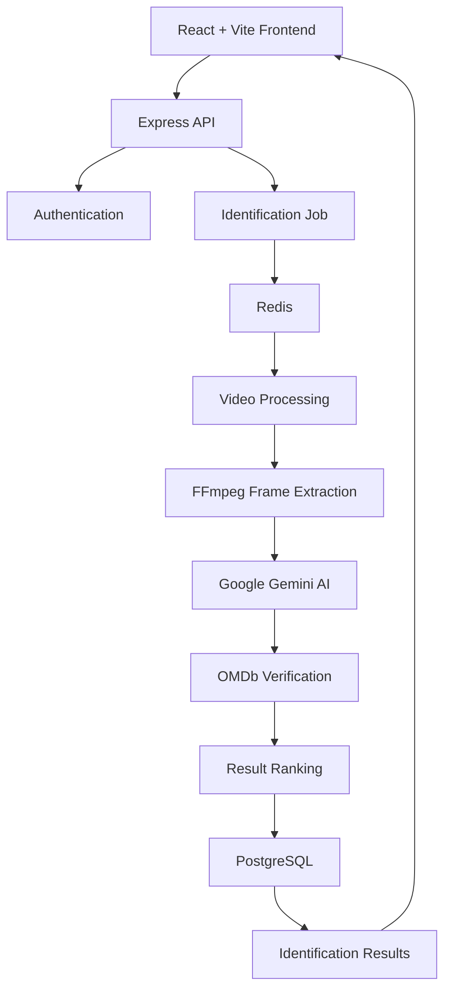

# 🎬 MobZilla

<h1 align="center">🎬 MobZilla</h1>

<h3 align="center">Don't Know the Movie? Let AI Find It.</h3>

<p align="center">
  An AI-powered movie and series identification engine that recognizes titles from video clips and YouTube Shorts.
</p>

<p align="center">
  
  
  
  
</p>

<p align="center">
  <a href="https://github.com/Byte-Hunter1/MobZilla">Repository</a> •
  <a href="#-screenshots">Screenshots</a> •
  <a href="#-installation--setup">Installation</a> •
  <a href="#-api-endpoints">API</a>
</p>

---

## 📌 Overview

Ever watched a random movie scene on Instagram or YouTube and wondered which movie it came from?

**MobZilla solves that problem.**

MobZilla is an AI-powered movie identification platform that analyzes video clips, extracts meaningful frames, and uses Google's Gemini AI to identify possible movies and TV series.

Instead of blindly trusting AI predictions, MobZilla verifies candidate titles using the OMDb API to improve identification accuracy.

Upload a clip or paste a public YouTube video link, and let MobZilla do the detective work.

## ✨ Features

- 🎥 **Video Upload:** Upload video clips directly for identification.
- 🔗 **YouTube Integration:** Identify movies from public YouTube videos and Shorts.
- 🧠 **AI Scene Recognition:** Google Gemini analyzes extracted video frames.
- 🎞️ **Frame Extraction:** FFmpeg processes videos and extracts relevant frames.
- 🔍 **Verified Results:** OMDb validates candidate movie and series titles.
- 🎯 **Multiple Matches:** Get possible identification results instead of relying on a single guess.
- 👤 **Authentication:** Secure user registration and login with JWT.
- ❤️ **Watchlist:** Save movies you want to watch or have watched.
- 📚 **Search History:** Access previous identification results.
- 🔎 **Scene Search:** Search using natural-language scene descriptions.
- 🎬 **Movie Discovery:** Explore featured movies and TV series.
- 📤 **Share Results:** Share movie identification results through unique links.

## 📸 Screenshots

<!-- Add your screenshots inside frontend/public/screenshots or docs/screenshots -->

### Homepage


### Movie Identification


### Identification Results


### Movie Details


### Watchlist


> Replace these images with actual screenshots of your application.

## 🛠️ Tech Stack

| Category | Technologies |
|---|---|
| Frontend | React, Vite, CSS |
| Backend | Node.js, Express.js |
| AI Engine | Google Gemini API |
| Video Processing | FFmpeg |
| Movie Database | OMDb API |
| Database | PostgreSQL |
| ORM | Prisma |
| Caching / Queue Infrastructure | Redis |
| Authentication | JWT |
| Containerization | Docker, Docker Compose |

## 🏗️ Architecture



### How It Works

1. **Input:** The user uploads a video or provides a public YouTube URL.
2. **Processing:** The backend validates the input and creates an identification job.
3. **Frame Extraction:** FFmpeg extracts representative frames from the video.
4. **AI Analysis:** Gemini analyzes the frames and suggests possible movie or series titles.
5. **Verification:** OMDb checks the suggested titles against its movie database.
6. **Ranking:** The backend ranks verified candidates.
7. **Results:** The frontend displays the identification results and relevant movie information.

## ⚙️ Installation & Setup

### Prerequisites

Make sure you have installed:

- Node.js 20+
- npm
- Docker and Docker Compose
- Google Gemini API key
- OMDb API key

FFmpeg is required locally unless you use the Docker-based FFmpeg setup.

### 1. Clone the Repository

```bash
git clone https://github.com/Byte-Hunter1/MobZilla.git

cd MobZilla
```

### 2. Start PostgreSQL and Redis

```bash
docker compose up -d
```

### 3. Configure the Backend

```bash
cd backend

cp .env.example .env

npm install
```

Configure your environment variables in `backend/.env`:

```env
JWT_SECRET=your_secure_jwt_secret
GEMINI_API_KEY=your_gemini_api_key
OMDB_API_KEY=your_omdb_api_key
```

Keep any additional required variables from `.env.example`, particularly database and Redis connection settings.

### 4. Initialize the Database

```bash
npx prisma db push
```

### 5. Start the Backend

```bash
npm run dev
```

Backend API:

```text
http://localhost:4000
```

Health check:

```text
http://localhost:4000/api/v1/health
```

### 6. Configure and Start the Frontend

Open another terminal:

```bash
cd frontend

npm install
```

Create `frontend/.env`:

```env
VITE_API=http://localhost:4000/api/v1
```

Start the frontend:

```bash
npm run dev
```

Open:

```text
http://localhost:5173
```

## 🔌 API Endpoints

Base URL: `/api/v1`

| Method | Endpoint | Description |
|---|---|---|
| POST | `/auth/register` | Register user |
| POST | `/auth/login` | Login |
| GET | `/auth/me` | Get current user |
| POST | `/identify/upload` | Upload video |
| POST | `/identify/url` | Identify YouTube video |
| GET | `/identify/status/:jobId` | Check processing status |
| GET | `/identify/results/:jobId` | Get identification results |
| POST | `/search/description` | Search by scene description |
| GET | `/movies/:imdbId` | Get movie details |
| GET | `/movies/:imdbId/recommendations` | Get recommendations |
| GET | `/watchlist` | Get user watchlist |
| GET | `/history` | Get identification history |
| GET | `/movies/discovery` | Discover movies and series |

For complete endpoint details, refer to the backend implementation.

## 🔒 Limitations & Security

- Instagram Reels are not directly downloaded because the application does not have an authorized Reel-fetching integration. Upload the video clip instead.
- Private YouTube videos cannot be processed.
- Supported uploads: MP4, MOV, and WEBM.
- Maximum upload size: 50 MB.
- Maximum video duration: 180 seconds.
- Gemini API usage is subject to your API quota.
- Never commit API keys, database credentials, or `.env` files.

## 🧪 Testing

Run backend checks:

```bash
cd backend

npm run check
npm run smoke
```

- `npm run check` validates ranking logic.
- `npm run smoke` checks API functionality and requires a running backend.

## 🚀 Future Improvements

- [ ] Improve scene-level identification accuracy.
- [ ] Add more advanced video frame selection.
- [ ] Add timestamp-based scene identification.
- [ ] Introduce an Instagram integration through an authorized API.
- [ ] Add more detailed identification confidence indicators.
- [ ] Improve recommendation personalization.
- [ ] Deploy the complete application with Docker.

## 👨‍💻 Author

**Vishesh Singh Rajput**

- GitHub: [@Byte-Hunter1](https://github.com/Byte-Hunter1)
- Project: [MobZilla](https://github.com/Byte-Hunter1/MobZilla)

---

<p align="center">
  Made with ❤️ and a little movie magic.
</p>

<p align="center">
  ⭐ If you like MobZilla, consider giving this repository a star!
</p>
